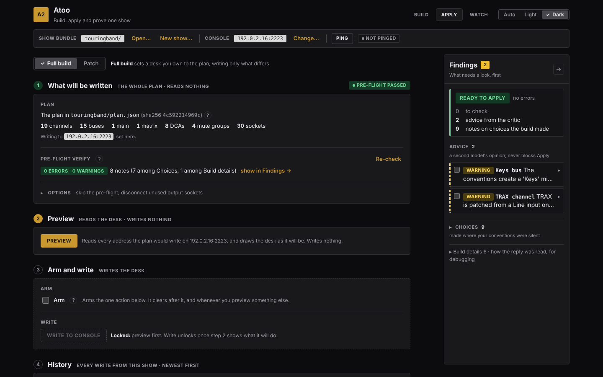

# Apply a plan to the desk

Set the desk to the whole show, and know which values landed, before the
band walks in.

A full apply is for a desk you are setting up: it puts the desk back to
its initialized state and sets everything the plan says, every fader
included. It writes only the addresses where the desk differs, as many as
the preview says will change, so applying a plan again after one more
channel was added sends that channel and nothing else. **If the show is
already on the desk and someone is using it, do not do this.** [Patch
it](patch-a-show.md) instead.

**Before you start:** a plan that reads **PLAN CURRENT** on Build step 04
([Build a show](build-a-show.md)), and the laptop on the same network as
the desk.

## 1. Point it at the desk

1. In the bar at the top, next to **Console**, press **Change…**.
2. Choose **Address** (if the console is the Demo, **Demo** is chosen),
   type the desk's IP address (the port is
   `2223` unless you changed it on the desk), and press **Use this
   console**.
3. Press **Ping**.

Next to **Ping**, a green **ANSWERED** tag is followed by the desk's
model, its address and the round trip in milliseconds. If a red **NO
REPLY** tag is followed by *no reply from 192.0.2.16:2223 -- is the
console reachable, and is its OSC remote enabled?*, see
[Troubleshooting](troubleshooting.md#atoo-cannot-reach-the-console).

Ping sends one message and reads nothing else, so it is safe to press at
any time, mid-show included. To keep the address between sessions, put it
in `~/.atoo.config` ([Setting up](configuration.md)).

## 2. Step 1: what will be written

Click **Apply**, and leave **Full build** chosen. The screen is four
numbered steps, done in order: **What will be written**, **Preview**,
**Arm and write** and **History**. Each step's title sits above its box,
with a short grey note of what it does (**Reads the desk · writes
nothing**). Its number is gold while it is the next thing to do and
green once it is done, and a green tag on the right, such as **Pre-flight
passed** or **Read 1667 addresses**, says what it found.

Step 1 names the plan, its sha256 and what is in it (channels, aux,
buses, mains, matrices, DCAs, mute groups and sockets, each when the
plan has any), and the **Pre-flight verify** line: the plan checked
again, against this desk's model, just before writing, as **0 errors ·
0 warnings** or a count. Its **?** says what it checks. Beside it, the
line counts the pre-flight's own notes by the **Findings** panel's two
folds, **Choices** and **Build details**, which hold the build's notes
too; **show in Findings** picks them out there.

- An **error** stops the write. Fix it on **Build** and rebuild.
- **Warnings** and notes do not stop it. Read them anyway.

**Options** holds two things you rarely need: **Skip the pre-flight
verify**, and **Disconnect output sockets the plan doesn't use**. Ticking
the second opens a box for the socket groups to clean and how many
sockets each has, such as `LCL=8,A=48`; its **?** says why you would.

## 3. Step 2: Preview

Press **Preview**. It reads every address the plan would write, and
writes nothing; it needs no arming. (After a rebuild, **Apply the
difference** on **Build** does this step for you: it opens Apply with
**Full build** chosen and runs the preview.) Step 2 then draws the desk as the
plan will leave it: every channel, aux, bus, main, matrix, DCA and mute
group as a scribble strip, in its colour, with its name and number.
Strips the plan does not use are dimmed, and a strip the write would
change has a blue outline. Above the drawing are the counts: addresses
read, how many will change, how many already match, and how many did
not answer. **All … changes, address by address** opens them with each value now
and after, the first 250 of a long list.

Once the preview is current, the button reads **Preview again** and is
no longer the gold one: the next thing to do is step 3. If you change
anything in step 1 after a preview, step 2 says the preview is out of
date, the button is **Preview** again, and the write stays locked until
you press it.

## 4. Step 3: Arm and write

1. Tick **Arm**. It is the only arming control in Atoo, and it
   clears itself after each write.
2. Press **Write to console**.

Until it can be pressed, **Write to console** has no colour and a dashed
edge, and **Locked:** beside it says why: **preview first**, or **tick
Arm first**. Armed, it turns solid red.

The command's own output runs under the button as it goes. A full write
first puts the desk back to its initialized state, writing only what
differs from it; on a WING Compact the read for that took about 35
seconds when reads went one request at a time, and should now be
shorter. It then goes through the plan, reads each address, writes only
those that differ, and reads every value it wrote back. The progress line
counts the settings it looks at; when it ends it says how many it wrote.

## 5. Read the result

The result is in the same step: for example **52 written · 52 read
back and confirmed**, then **Nothing failed to land. The desk now
matches the plan. 1715 addresses were already right and left alone.**
The 52 is the number the preview said would change; if the desk moved
after the preview, the write goes by what it reads now. When something did not land, it says how many and
names them: each value the desk holds differently from the one written,
and each address that could not be read back. **The journal** under it
has every address, with the ones that did not land opened first.

Each confirmed write is recorded in the show's `journals/` folder, and
appears at the top of **History**, step 4, highlighted.

## Undo the last write

**History** lists every write from this show, newest first. The row
marked **top** is the newest write still standing on this desk.

1. Press **Preview undo**. It reads the desk and writes nothing, and it
   needs no **Arm**. Directly under the button it says which write it would
   reverse, whether it is **safe to undo**, and lists the addresses: for
   each one the strip, the value that write set, the value on the desk now,
   and the value Undo would put back. Anything that has been **changed
   since** the write, by hand or by another run, is listed first and marked:
   Undo leaves it exactly as it is. Step 3's account of the last write
   stays where it is.
2. Tick **Arm** in step 3, then press **Undo newest write**. If it had to
   leave addresses behind, the result says **Partly undone** in yellow and
   lists them.

With no row to undo on this desk, both buttons are locked, and
**Locked: nothing to undo on this desk** says so.

Undo puts back only the addresses that write changed, and only where
nothing has written over them since. Undo again to step back one more.

## When it does not work

- **FULL BUILD FAILED, and** `apply.failed` **in the Findings panel**: the
  run log in step 3 is the command's own output, word for word, and its
  last line says why.
- **PREVIEW FAILED, and** `preview.failed`: the same, for a preview.
  Nothing was written. Usually the desk did not answer: check its
  address and that its OSC remote is on.
- **The pre-flight shows an error about a socket**: the plan patches a
  socket this desk does not have, perhaps because it was built for a
  different WING. Choose the right **Console model** on Build step 04 and
  rebuild.

The command-line version of this page is
[Applying a plan](applying.md).
