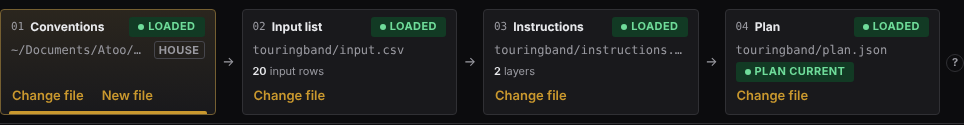
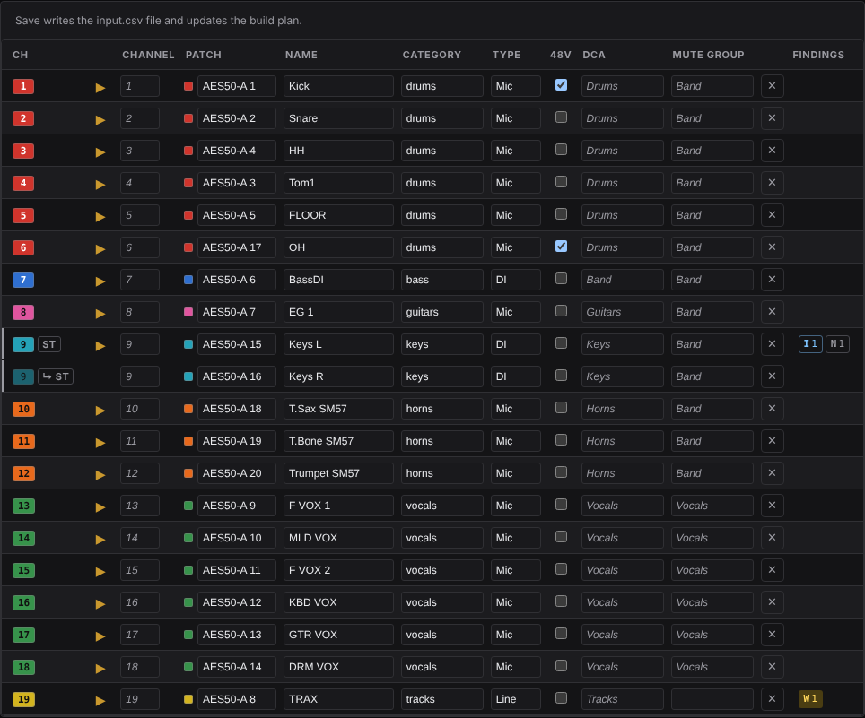

# Build a show

Tonight's band, laid out by your own house rules, as a plan you can read before anything goes near the desk.

**Before you start**, once per laptop:

- `atoo init` makes `~/Documents/Atoo` with a starter house conventions file and a preset library, and points Atoo at them ([Set up Atoo](configuration.md#1-create-your-atoo-folder-atoo-init)).
- A build needs a model: a Claude API key, or a local model through Ollama ([Setting up an AI provider](ai-provider.md)).

## 1. Make the show

1. Run `atoo ui`. The browser opens on **Build**.
2. Next to **Show bundle**, press **New show…**.
3. Type a name under **New show folder**, say `friday-club`, and press **Create show**.

Next to **Show bundle**, the bar reads **friday-club/**. That folder holds all of this show's files ([Show bundles](show-bundles.md)).

The Atoo header (**Build**, **Apply**, **Watch** and the theme) and the **Show bundle / Console** bar stay at the top of the window however far you scroll, in Build and in Apply, with the step tiles and **Findings** just below them. On a phone-width window only the Atoo header stays; the bar scrolls away with the page.

## 2. Check your house rules: 01 Conventions

**Build** is four tiles, one per file and then the plan. On a show that is ready, they look like this:



Each tile has a state on the right: green **LOADED** for a file that was read, gray **NOT SET**, red **MISSING** for a file the build needs that is named but not there, and yellow **STALE** for a file that changed on disk after the page read it. Instructions are optional, so a show without an `instructions.md` reads a gray **NOT SET** on 03, not red. Under it is the file's path (with **HOUSE** beside it on 01), then the tile's count (its findings, the input rows, the layers) and, last, **Change file** (and **New file** where one can be started). The four tiles are always the same height as each other.

The 01 tile reads **LOADED** with your house file's path, tagged **HOUSE**. It is the same file for every show, so leave it alone unless the change is true of every show you do. To read or edit it, click the tile. Once you type in it, a yellow **EDITING HOUSE STYLE** tag and a warning come up beside **Save** and **Discard**. [Writing conventions](conventions.md) says what goes in it.

## 3. Say what is plugged in: 02 Input list

Either:

- press **Change file** on the tile and choose the band's CSV. It is copied into the show as `input.csv`, and the bar shows the new file; or
- click the tile, press **+ Add row**, and type each input.

Each row is one thing plugged in, with the [input list's columns](input-lists.md#the-columns) in their order: **Order**, **Channel**, **Patch** (the socket, such as `AES50-A 1`), **Name**, **Category**, **Type**, **Model**, **Phantom**, **Preset**, **DCA**, **Mute group**, **Notes** and **Stagebox** (your own label for the box input, such as `Pink 12`; Atoo never reads it as a socket). Name, Category and Type are required: until they are filled in they read *required* and are outlined. Leave **Patch** blank and the build chooses a socket and tells you which. A stereo pair whose two rows state sockets the desk cannot pair, such as `LCL 4` and `LCL 5`, is still built as one stereo channel, through two of the desk's user patch slots, and the build reports it ([how](input-lists.md#when-the-cabling-cannot-give-you-an-adjacent-pair)). A socket the desk does not have is refused as you type it. Once you change a cell, a yellow **UNSAVED CHANGES** tag comes up at the top of the step with **Discard changes** and **Save**, where steps 01 and 03 have theirs, and they stay there as the list scrolls. Press **Save**.

The tile now reads **LOADED** and counts the rows: *20 input rows*. [Writing an input list](input-lists.md) covers the columns and stereo pairs.

A `-` in a row's **Order** cell leaves it out of the next build: the row stays in the file, dimmed ([more](input-lists.md#the-order-column-band-numbers-and-skipping-a-row)).

**Print**, beside **View source**, opens the list as a page to print or save as a PDF for the stage: the show's name and the date at the top, then one row per input with **Input** (the Order number), **Name**, **Stagebox**, **Type**, **Model**, **48V**, **Patch** and **Notes**. It is black on white in either theme, fits a Letter or an A4 page, and repeats the header row on every page. A skipped row is left out. It prints `input.csv` as saved, so the button is locked while there are unsaved changes: press **Save** first.

## 4. Tonight's exceptions: 03 Instructions (optional)

Anything true of this show only: *"MON5 and MON6 are stereo in-ear mixes"*, *"no reverb on the speech mics"*. Press **New file** on the tile (or **Create instructions.md** in the step itself), type, and press **Save**. Where these and your house rules disagree, the instructions win. Without a file, the house rules apply in full. The tile counts the layers the build reads: *2 layers* is the house file, then these instructions on top.

## 5. Build the plan: 04 Plan

1. Click the **04 Plan** tile. The step opens on the **Plan** box, whose first part is **Options**.
2. Under **Console model**, choose your desk: **WING Compact**, **WING (full-size console)** or **WING Rack**.
3. **Run the critic pass** is ticked: a second model reads the plan against your conventions and reports where it disagrees. A line of yours it finds left out, quoted word for word, goes back to the model once to be carried out. Untick it to skip that call.
4. Press **Build plan**.

**Options** folds: click its heading to close it. Closed, it still says which WING and whether the critic runs, and the page remembers the choice. A build opens it again.

Options shows what the model is doing while it works, with a clock and a **Stop** button, and its heading reads **BUILDING**. A build takes a few minutes. When it lands, the tile reads **PLAN CURRENT**, and the Plan box gains two more parts:

- **Build output**: the file, when it was built and for which WING; verify's verdict and a count of the findings, with a link into the **Findings** panel; one line of counts (channels, aux, busses, outputs, DCAs, mute groups, inputs left unassigned); and a folded **▸ Details** line holding the model's own notes and how the build read its reply. On the right of its heading, **PLAN CURRENT** or **STALE**.
- **Changed since the last build**, after a rebuild only: what changed against the plan this one replaced, one line per strip. It is open when a change was not asked for, and folded otherwise. [What a rebuild changed](pipeline.md#what-a-rebuild-changed) explains it. Above the counts, a rebuild that changed something also shows a line with **Apply the difference**: it takes you to **Apply** with **Full build** chosen and the preview already run, so the next thing you read is how many addresses will change. It writes nothing.

Below the box, the plan is three tables, and each is a sheet you can edit. **Channels** is your input list, one row per input: channel, patch, name, category, type, 48V, DCA and mute group. **Busses** and **Mains and Matrix** are the show's `busses.csv`, one row per bus, Main and Matrix: name, role, width, sources, tap and outputs. A build lays the bus sheet onto the plan it makes, so a filled cell there wins over your conventions, and each change is a note under **Choices**. A cell you left empty shows, in gray, what the plan put there. Press **▸** on any row for the rest of its cells, and for its high-pass, sends, color and the reason for each value. After a rebuild, a strip that changed carries **ADDED**, **CHANGED** or **MOVED** by its number: yellow when nothing it is made from changed, gray when your edit asked for it.

Type in a cell and press **Save**: it writes the file and updates the plan straight away, with no model, as the note under each table says. A cell that cannot work on the desk (a socket it does not have, two inputs on one channel) turns red with the reason, and Save waits until it is fixed. [Editing the sheets](capture.md#editing-the-sheets) has the details.



### Let the model say less: `--intent`

`atoo build --intent` asks the model for a short **intent** instead of the plan's reply. Atoo's own code writes one channel for every input-list row, in the list's order, with what the list says of it (source type, microphone, phantom power, category, preset, and the socket it states). The model writes only what the list cannot say: a stereo pair, a strip your conventions name differently, the DCAs, mute groups, buses and outputs your conventions ask for (each with its members, by category or by name), the order of the strips by category, and the settings each category gets. Atoo works out the strips, a socket for every row that names none, the group and bus numbers and every range, and says each choice in a NOTE. It does not need the separate rewrite of your conventions (`atoo resolve`).

A row is left out only when your conventions, the instructions or the row's own notes ask for it in words the model can quote; otherwise the row is built, with a NOTE. The result is the same kind of plan, verified and written like any other build.

```bash
atoo build --show touringband --intent
```

It is new and sits beside the default form until it does as well; the [patch page](patch.md#let-the-model-say-less---intent) explains the idea. It is the way to build with a local model: [Which model](ai-provider.md#which-model) says which one to use.

`--intent-steps` asks for the same intent in three shorter calls instead of one: first the categories and the exceptions, then the buses, then the DCAs, mute groups and outputs. Each call writes only its own part and is checked against what the calls before it built. It implies `--intent`. With a local model it is the default, because there the three calls build more of the show than one: Ollama, or the `api` provider when `ATOO_AI_BASE_URL` is on this machine or your network (`localhost`, a `.local` name, a private address). `--no-intent-steps` asks in one call. Claude, and the `api` provider on a remote host, ask in one call unless you give `--intent-steps`. The build says which in a NOTE.

## 6. Read the findings

The **Findings** panel down the right starts with a verdict: **Ready to apply** or **Blocked** (or **No plan yet**, before the first build), and how many things there are to check. Below it, each finding is one line: its severity, the strip, named as the desk names it (`CH 23 Crowd`), and what is wrong. Click a line for the explanation, the fix and a link to the row it is about.

- **ERROR**: the plan cannot be written as it stands, and the verdict reads **Blocked**. Fix the file the finding points at and build again.
- **WARNING**, under **To check**: it can be written, but look first. The verdict counts them: **Ready to apply · 1 to check**. A rebuild's change that nothing you edited asked for is one of these (`rebuild.unasked-change`), one per strip.
- **Advice**: the critic's disagreements, a second model's opinion. Read them, but they never block an apply.
- **INFO**, under **To review**: where the desk differs from the plan, or something to check, such as a DCA nobody joins. The verdict counts them: **Ready to apply · 2 to review**. If the desk is right, put it into the plan; if the plan is right, put the desk back.
- **NOTE**, folded under **▸ Choices**: choices the plan made that your files did not state, each saying what it was decided from. If one is not what you meant, say so in your conventions or instructions. **▸ Build details** holds notes on how the build read the model's draft, and on what your conventions and presets put into the plan as asked (the preset values it carries, what the Category table filled in); you can leave it closed.

[Reading findings](reading-findings.md) explains the codes and verdicts.

## When you change a file

Save an edit to any of the three files and the **04 Plan** tile reads **STALE**. So does **Build output**, which lists which file changed. An edit made in step 04's tables is the exception: its Save updates the plan too, so it stays current, and [Build Changes](#build-the-rows-you-saved) gives a row you added or changed what your conventions say for it. To build the whole plan again instead, press **Rebuild Plan**. When the rebuild lands, **Changed since the last build** says what it changed, and **Apply the difference** takes you to the preview of it. A full build writes only the addresses where the desk differs from the plan, so applying the rebuilt plan sends just the change.

Once the show has a plan, **Build plan** is named **Rebuild Plan**: it builds the plan again from scratch, and only what the sheets and your conventions state survives. A [Patch](patch-a-show.md) you did not keep with **Keep this in the show** is lost. A rebuilt plan says `made_from: built`. On a [captured show](capture.md#rebuild-plan-on-a-captured-show), Rebuild Plan is a secondary button and asks first, naming by strip what only the captured plan holds and the rebuild discards: a channel's inserted effects, the desk's colors, the DCA and mute-group numbers, and descriptions. It also says that the next full Apply resets the desk.

### Build the rows you saved

A Save in step 04's tables is instant and needs no model, so it does only what the cells say. A channel you add is patched and named, with no preset, color, DCA or sends yet. A row whose category you change keeps what the last build gave it. Each such row is tinted in its table and tagged **SAVED, NOT BUILT**, and a line under **Compile** names them. You can Save at the desk with no API key and build these rows later with one.

1. Under **Compile**, press **Build Changes**. Its button counts the rows.
2. The model reads your conventions and `instructions.md` and works out what they give those rows, and nothing else. The panel above shows it running, with **Stop**.
3. Read the preview. It has four parts:
   - the rows;
   - what your conventions add to each;
   - the spillover, every bus, DCA or mute group outside the rows that gains them;
   - what keeping it writes.

   Whatever a row's sheet states stays as it is. A blank cell stays blank: the plan holds the value your conventions chose, and a rebuild decides it again.
4. Press **Keep in plan.json**. It writes `plan.json` and the sheet cells that must follow, such as a bus's filled **Sources** cell gaining the new channels. The rows lose their tag, and the plan reads current again when those rows were all you changed in the input list. If you changed other rows too, it stays **STALE**, and the note names them. Then press **Apply the difference** to write the desk, or **Back out** to put the plan back.

Nothing outside the rows you saved is rebuilt. If your conventions would move something you did not touch, such as a DCA renumbered with the strips on it, the whole change is refused and nothing is written. The refusal names what would move and the two ways out: fill the cell on your saved rows and Save, or use **Rebuild Plan**. On a captured show, Build Changes keeps the plan captured: only your rows and what they spill into change.

From a terminal, `atoo build-changes --show DIR` prints the same preview, and `--confirm` keeps it.

### Backing out the last change to the plan

Everything that writes `plan.json` keeps the plan it replaces as `plan.previous.json`, one generation: a rebuild, a Save in step 04's tables, **Build Changes**, **Keep this in the show** on Apply, and `atoo presets --expand`. Each says what it changed against it, strip by strip, so you see the spillover (a bus renumbered, and every send into it) before you decide. A Save says it in its note. Moving a bus's outputs from LCL 1-2 to AUX 1-2 in the Outputs table says *What this Save of outputs.csv changed in plan.json -- 1 strip against plan.previous.json: 1 changed: BUS 9 Presentr: destination.patch LCL 1+2 -> AUX 1+2; …*, then *Back out puts the plan from before this Save back (plan.previous.json).*

While there is a `plan.previous.json`, step 04 has a line under the plan: *plan.previous.json holds the plan the last Save, Keep or build replaced*, with **Back out**. Press it, and it says what it will do; press **Back out: yes** to do it. `plan.json` becomes that plan again, and the note says what that changed. It goes one step back: the plan it replaces is not kept, so there is no second Back out until something writes `plan.json` again.

**Back out leaves the sheets as they are.** A Save changed a sheet and the plan; backing out puts back the plan only, so that sheet now differs from it, and the note names it: *The sheets were not changed: busses.csv and outputs.csv now differ from plan.json. Save the sheet again, or rebuild, to bring the plan to it.* The **04 Plan** tile reads **STALE** for it. Save the sheet again, or rebuild, to bring the plan to it.

The same, from a terminal:

```bash
atoo back-out --show ~/Documents/Atoo/my-show
```

With nothing to put back, it changes nothing and prints:

```
Nothing to back out: there is no plan.previous.json. Back out goes one step back, to the plan the last Save, Keep or build replaced, and that step has been taken or there was none.
```

**Back out puts back only a plan.** A `plan.previous.json` that is not a plan (an empty `{}`, say) is left where it is:

```
Nothing was backed out: plan.previous.json does not load as a plan, so plan.json was left as it is.
```

A plan records the folder its sheets were in. One made in another folder (the show folder was moved or renamed and then rebuilt, or another show's plan was copied in) is put back as asked, with a WARNING naming that folder, so you can tell if it is not the plan you meant:

```
Backed out: plan.json is the plan the last change replaced, from plan.previous.json. That was one step; there is nothing further to back out to.
WARNING: plan.previous.json was made in …/festival, not this show's folder; restored all the same.
```

## When it does not work

- **Build plan does nothing but say** *Choose the console model first -- a build refuses to guess it.* Choose one under **Console model**.
- **BUILD FAILED, with** `build.failed` **in the Findings panel** saying *a build needs a model: the default is Claude, which needs an API key in ANTHROPIC_API_KEY*. Set up a model ([Setting up an AI provider](ai-provider.md)), restart `atoo ui`, and build again.

Next: [Apply it to the desk](apply-to-desk.md).
