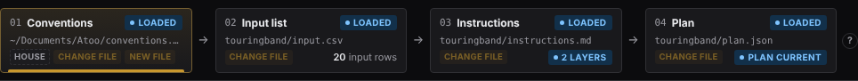
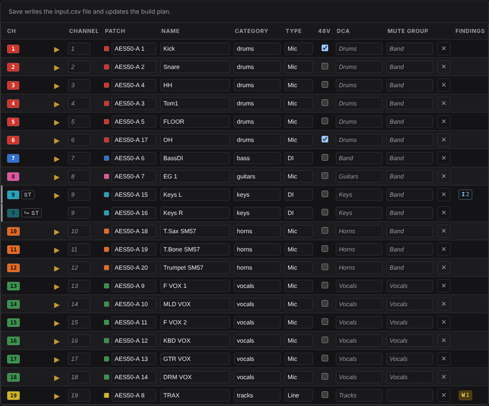

# Build a show

Tonight's band, laid out by your own house rules, as a plan you can read before anything goes near the desk.

**Before you start**, once per laptop:

- `atoo init` makes `~/Documents/Atoo` with a starter house conventions file and a preset library, and points Atoo at them ([Set up Atoo](configuration.md#1-create-your-atoo-folder-atoo-init)).
- A build needs a model: a Claude API key, or a local model through Ollama ([Setting up an AI provider](ai-provider.md)).

## 1. Make the show

1. Run `atoo ui`. The browser opens on **Build**.
2. Next to **Show bundle**, press **New show…**.
3. Type a name under **New show folder**, say `friday-club`, and press **Create show**.

Next to **Show bundle**, the bar reads **friday-club/**. That folder holds all of this show's files ([Show bundles](show-bundles.md)).

The Atoo header (**Build**, **Apply**, **Watch** and the theme) and the **Show bundle / Console** bar stay at the top of the window however far you scroll, in Build and in Apply, with the step tiles and **Findings** just below them. On a phone-width window only the Atoo header stays; the bar scrolls away with the page.

## 2. Check your house rules: 01 Conventions

**Build** is four tiles, one per file and then the plan. On a show that is ready, they look like this:

Each tile has a state on the right: green **LOADED** for a file that was read, gray **NOT SET**, red **MISSING** for a file the build needs that is named but not there, and yellow **STALE** for a file that changed on disk after the page read it. Instructions are optional, so a show without an `instructions.md` reads a gray **NOT SET** on 03, not red. Under it is the file's path (with **HOUSE** beside it on 01), then the tile's count (its findings, the input rows, the layers) and, last, **Change file** (and **New file** where one can be started). The four tiles are always the same height as each other.

The 01 tile reads **LOADED** with your house file's path, tagged **HOUSE**. It is the same file for every show, so leave it alone unless the change is true of every show you do. To read or edit it, click the tile. Once you type in it, a yellow **EDITING HOUSE STYLE** tag and a warning come up beside **Save** and **Discard**. [Writing conventions](conventions.md) says what goes in it.

## 3. Say what is plugged in: 02 Input list

Either:

- press **Change file** on the tile and choose the band's CSV. It is copied into the show as `input.csv`, and the bar shows the new file; or
- click the tile, press **+ Add row**, and type each input.

Each row is one thing plugged in: **Name**, **Category**, **Type**, **Model**, **Phantom**, **Preset**, **Notes** and **Patch** (the socket, such as `AES50-A 1`). Name, Category and Type are required: until they are filled in they read *required* and are outlined. Leave **Patch** blank and the build chooses a socket and tells you which. A socket the desk does not have is refused as you type it. Once you change a cell, a yellow **UNSAVED CHANGES** tag comes up at the top of the step with **Discard changes** and **Save**, where steps 01 and 03 have theirs, and they stay there as the list scrolls. Press **Save**.

The tile now reads **LOADED** and counts the rows: *20 input rows*. [Writing an input list](input-lists.md) covers the columns and stereo pairs.

## 4. Tonight's exceptions: 03 Instructions (optional)

Anything true of this show only: *"MON5 and MON6 are stereo in-ear mixes"*, *"no reverb on the speech mics"*. Press **New file** on the tile (or **Create instructions.md** in the step itself), type, and press **Save**. Where these and your house rules disagree, the instructions win. Without a file, the house rules apply in full. The tile counts the layers the build reads: *2 layers* is the house file, then these instructions on top.

## 5. Build the plan: 04 Plan

1. Click the **04 Plan** tile. The step opens on the **Plan** box, whose first part is **Options**.
2. Under **Console model**, choose your desk: **WING Compact**, **WING (full-size console)** or **WING Rack**.
3. **Run the critic pass** is ticked: a second model reads the plan against your conventions and reports where it disagrees. A line of yours it finds left out, quoted word for word, goes back to the model once to be carried out. Untick it to skip that call.
4. Press **Build plan**.

**Options** folds: click its heading to close it. Closed, it still says which WING and whether the critic runs, and the page remembers the choice. A build opens it again.

Options shows what the model is doing while it works, with a clock and a **Stop** button, and its heading reads **BUILDING**. A build takes a few minutes. When it lands, the tile reads **PLAN CURRENT**, and the Plan box gains two more parts:

- **Build output**: the file, when it was built and for which WING; verify's verdict and a count of the findings, with a link into the **Findings** panel; one line of counts (channels, aux, busses, outputs, DCAs, mute groups, inputs left unassigned); and a folded **▸ Details** line holding the model's own notes and how the build read its reply. On the right of its heading, **PLAN CURRENT** or **STALE**.
- **Changed since the last build**, after a rebuild only: what changed against the plan this one replaced, one line per strip. It is open when a change was not asked for, and folded otherwise. [What a rebuild changed](pipeline.md#what-a-rebuild-changed) explains it. Above the counts, a rebuild that changed something also shows a line with **Apply the difference**: it takes you to **Apply** with **Full build** chosen and the preview already run, so the next thing you read is how many addresses will change. It writes nothing.

Below the box, the plan is three tables, and each is a sheet you can edit. **Channels** is your input list, one row per input: channel, patch, name, category, type, 48V, DCA and mute group. **Busses** and **Mains and Matrix** are the show's `busses.csv`, one row per bus, Main and Matrix: name, role, width, sources, tap and outputs. A build lays the bus sheet onto the plan it makes, so a filled cell there wins over your conventions, and each change is a note under **Choices**. A cell you left empty shows, in gray, what the plan put there. Press **▸** on any row for the rest of its cells, and for its high-pass, sends, color and the reason for each value. After a rebuild, a strip that changed carries **ADDED**, **CHANGED** or **MOVED** by its number: yellow when nothing it is made from changed, gray when your edit asked for it.

Type in a cell and press **Save**: it writes the file and updates the plan straight away, with no model, as the note under each table says. A cell that cannot work on the desk (a socket it does not have, two inputs on one channel) turns red with the reason, and Save waits until it is fixed. [Editing the sheets](capture.md#editing-the-sheets) has the details.

## 6. Read the findings

The **Findings** panel down the right starts with a verdict: **Ready to apply** or **Blocked** (or **No plan yet**, before the first build), and how many things there are to check. Below it, each finding is one line: its severity, the strip, named as the desk names it (`CH 23 Crowd`), and what is wrong. Click a line for the explanation, the fix and a link to the row it is about.

- **ERROR**: the plan cannot be written as it stands, and the verdict reads **Blocked**. Fix the file the finding points at and build again.
- **WARNING**, under **To check**: it can be written, but look first. The verdict counts them: **Ready to apply · 1 to check**. A rebuild's change that nothing you edited asked for is one of these (`rebuild.unasked-change`), one per strip.
- **Advice**: the critic's disagreements, a second model's opinion. Read them, but they never block an apply.
- **INFO**, folded under **▸ Choices**: choices the plan made that your files did not state, each saying what it was decided from. If one is not what you meant, say so in your conventions or instructions. **▸ Build details** holds notes on how the build read the model's draft, and on what your conventions and presets put into the plan as asked (the preset values it carries, what the Category table filled in); you can leave it closed.

[Reading findings](reading-findings.md) explains the codes and verdicts.

## When you change a file

Save an edit to any of the three files and the **04 Plan** tile reads **STALE**. So does **Build output**, which lists which file changed. An edit made in step 04's tables is the exception: its Save updates the plan too, so it stays current, unless you changed a cell the plan has no place for (a category, a note, a preset), which only a rebuild reads. Press **Rebuild plan**. When the rebuild lands, **Changed since the last build** says what it changed, and **Apply the difference** takes you to the preview of it. A full build writes only the addresses where the desk differs from the plan, so applying the rebuilt plan sends just the change.

## When it does not work

- **Build plan does nothing but say** *Choose the console model first -- a build refuses to guess it.* Choose one under **Console model**.
- **BUILD FAILED, with** `build.failed` **in the Findings panel** saying *a build needs a model: the default is Claude, which needs an API key in ANTHROPIC_API_KEY*. Set up a model ([Setting up an AI provider](ai-provider.md)), restart `atoo ui`, and build again.

Next: [Apply it to the desk](apply-to-desk.md).
