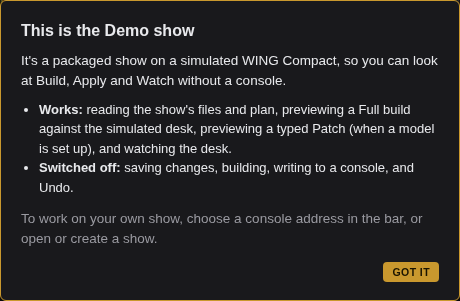
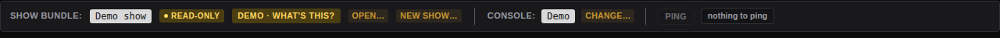
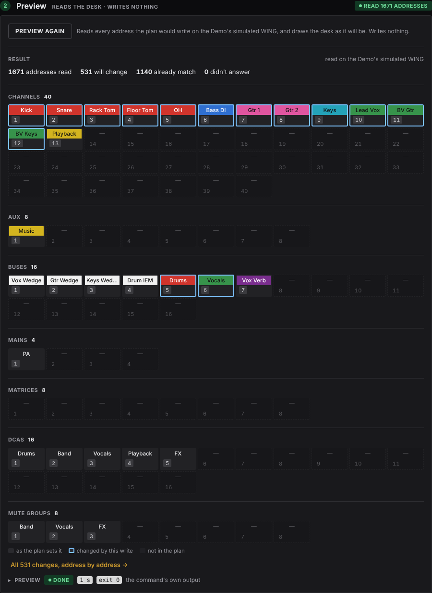

# Try the Demo show

The Demo show includes an input list and instructions for a five-piece band with backing tracks on a simulated WING Compact: drums (kick, snare, two toms, stereo overheads), a bass DI, two guitar amps, a stereo keyboard, a lead and two backing vocals on a stage box over AES50, and a stereo playback laptop on the desk's own inputs. Three mono wedges and a stereo in-ear mix, five DCAs, three mute groups.

Choosing the Demo show instead of a live console lets you view the apply preview and watch modes against a simulated desk, with no API key required.

## Open it

1. Start the browser UI (See: [installing](install.md) if you have not installed Atoo yet.):

   ```bash
   atoo ui
   ```

2. With no show open, the line under the bar reads **No show open.** Press **Try the Demo show**.

   Or, at any time: next to **Console** in the bar, press **Change…**, choose **Demo**, then press **Use this console**.

A box opens, explaining what the Demo show is.





## Build: the files and the plan

**Build** is four steps across the top. Click each tile to open it. Each tile reads a green **LOADED**. Nothing in the Demo can be saved so the **READ-ONLY** badge replaces the usual **Open...** and **New Show...** options.

To get an editable version of the demo show, copy it into your directory with `atoo init --demo`.

The four components of a show:

- **01 Conventions**: your conventions, or the house rules, in plain English. This is where you set colors, channel presets, DCA and mute group members, and output configuration. Edit this file to suit your preferences common to all shows.
- **02 Input list**: your band's inputs with additional notes and settings. The `Order` column is the band's own numbering; a row with a dash (`-`) in it is skipped. `Category` will be used to build DCAs, mute groups and mix busses. `Type`, `Model` and `Notes` are just documentation for now. Phantom will turn on phantom power for that channel and the `Patch` can be left blank or used to specify hard patch targets. 
- **03 Instructions**: additions and exceptions for this show only. Can include bus routing, extra channels, and anything specific to this show. **2 layers** means the conventions file is read first, then these instructions layer on top.
- **04 Plan**: what will be built on the desk. One row per channel with its number, input source, phantom power, DCAs and mute groups. Press **▸** on a row to open up its preset, sends, color and where each value came from. **PLAN CURRENT** on the tile means the plan was built from the files as they are now.

The **Findings** panel down the right holds everything the checks said about the plan. It starts with the verdict: **Ready to apply**, with 0 to check, 0 advice from the critic and 6 notes on choices the build made.

Twelve channels carry a preset from the starter library: Kick takes **Kick In**, the toms **H Tom** and **Fl Tom**, the three singers **Vocal**, and so on, and the plan holds each preset's values (▸ on a row in **04 Plan** shows `Kick In (83 values)`).

Expand: 
- **Choices** -- **AUX 1 Music is not on the input list** -- then click on it to see the underlying rationale (a strip built from the instructions is always reported). Further down you can see notes about the skipped guest vocal, the two choices made for the Vox Verb bus's reverb, and what a full apply does beyond the plan's own strips.
- **Build details** holds nine more notes about how the build read the draft and what it carried into the plan: the preset values the channels and busses carry, the reverb loaded and read back, the Music strip, channel numbers, colours, sends, and what a full apply's reset does.

## Apply: a preview on the simulated desk

In the top menu header, click **Apply**. 

When connected to a real desk this is the only screen that writes. 

Its first step, **What will be written**, names the plan, its contents, and its **Pre-flight verify results**: **0 errors · 0 warnings**, showing that the plan can be written as it stands. Beside it are listed the notes added by the pre-flight, click on `show in Findings` to have them highlighted in the Findings panel.

Press **Preview**. It reads the Demo's simulated WING, a WING Compact with the show already on it, exactly as it would read a real desk, and draws the desk as the plan will leave it: **1667 addresses read**, **444 will change**, **1223 already match**, **0 didn't answer**. In this example the 444 are mostly channel and bus processing which the simulated desk doesn't have yet.



**Write to console** and **Preview undo** (on the empty History line) are switched off in the Demo show.


## Watch: the show, live

In the top menu header, click **Watch**, then **Start watching**. The simulated desk has faults that come and go at random, so within a few seconds the table fills:


The word over the table says it from across the room: a red **TROUBLE** while an error stands, a yellow **WARNING** with warnings only, a green **ALL OK** when the faults have gone.

Rules starting `WATCH:` are the show's own watch conditions, listed as text under **Watch conditions** below in the table; rules named by a code such as `R005` are built-in checks.


The **Watch conditions** table is normally editable. Rules with a **YOURS** badge are entries you have added, rules with **DRAFTED** are entries created by the plan build step.

Press **Stop** when you have seen enough.

We haven't covered patching, for making last minute changes as it needs an API key. To learn about that flow, on a real desk, see [Patch a show](patch-a-show.md).

## Leave the demo

Press **Change…** next to **Console** and choose **Address** to use a real desk, or open or create a show with **Open…** or **New show…** next to **Show bundle**.

## Next

- [How Atoo works](how-atoo-works.md): the files and the steps behind what you just saw.
- [Why Atoo?](why.md), if you are still deciding.
