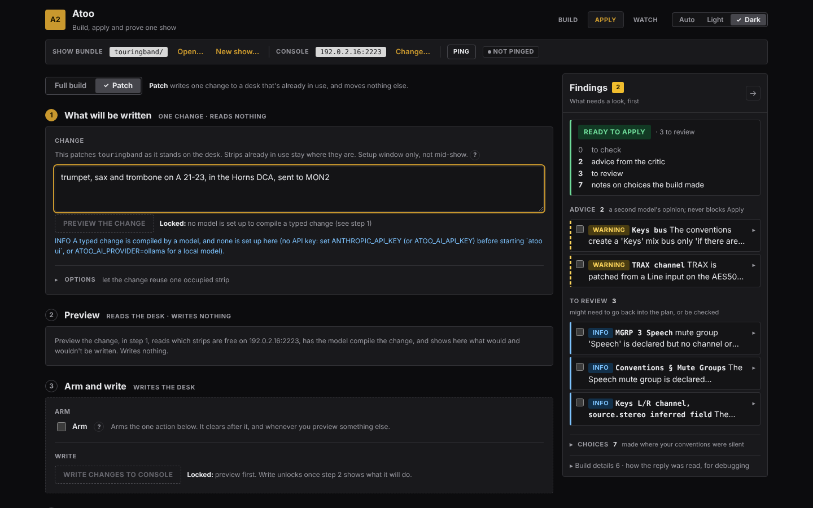

# Patch a show

Once a show is on the desk, a change goes on as a patch: you type it in plain English, Atoo works out exactly what to write, shows you, and writes only that. Nothing already in use moves. For example, a horn section turns up just before doors, and three channels have to go onto a desk that is already set up and line-checked.

**When:** in the setup window, after the full apply and before doors. Not mid-show. Save a snapshot on the desk once it is patched, so the worst a bad change can cost is a reload.

**Before you start:** the show applied to this desk ([Apply a plan](apply-to-desk.md)), the console set in the bar, and a model set up, as for a build.

## 1. Type the change

Patch shares Apply's four numbered steps: **What will be written**, **Preview**, **Arm and write** and **History**.

1. Click **Apply**, then choose **Patch** in the **Full build | Patch** control at the top.
2. In step 1, type what changed, naming the sockets you have cabled:

   > trumpet, sax and trombone on A 21-23, in the Horns DCA, sent to MON2

   Leave a socket out and one is chosen for you, and the review says which.
3. Press **Preview the change**, under the box (or Ctrl+Enter, ⌘+Enter on a Mac). Until a change is typed it is locked, and **Locked:** beside it says what it is waiting for. In Patch mode, step 2 has no button of its own: it is where the preview shows.

It reads which strips on the desk are free, and each strip's name and color (a few seconds), sends your words, the plan on the desk and your conventions to the model, and shows progress while it works. It writes nothing.

## 2. Review it

Step 2 draws the desk as its scribble strips: every channel, aux, bus, main, matrix, DCA and mute group, in its color, with its name and number. Strips in use are drawn solid, free strips dashed, the strips this change adds have a green outline, the ones it edits a blue one, and the ones an insert moves a dashed blue one. A strip that never answered the read is hatched: it is treated as in use, never as free.

**Click a tile to see its Detail** in the side bar, as on a full preview ([Apply a plan](apply-to-desk.md)): what this change writes on that strip, now and after. A socket the change writes for a strip is listed under the strip, headed by the socket, so clicking MON1 after *"remove all the StageConnect outputs"* shows **SC 1, source group: BUS → OFF**. A strip the change does not touch shows that it is untouched.

Under the drawing, **Changes, old → new** says what the change does: one line for each object it adds, drops, moves or edits, in words. Where something goes out is said whole, with what goes off named: *output 'Matrix 1': out on LCL 7-8, AES50-A 1-2 -> LCL 7-8 (AES50-A 1-2 off)*. A change that cannot be written is listed first, headed **Refused** with why: it names something not on the desk, has no free strip, or patches a socket past the end of the stage box on an AES50 port (`A 17` on an S16: the pre-flight panel names the box and its size). Then the count of addresses that will be written. That is all step 2 shows; what the command printed in full (each strip's verdict, what is left alone, the untouched-strip proof) is folded under **Patch preview** at its foot.

The notes are in the **Findings** panel, each once: what was chosen where your words left it open (NOTE), what to look at (WARNING), and what the pre-flight finds in the plan as the change leaves it, such as a bus that no longer goes anywhere. While the preview stands, the panel shows that state, and its subtitle reads: *What needs a look, first: the plan with the change '…' (Patch preview)*. The plan's own findings are set aside and come back when you choose **Full build**, leave Apply, or the change is refused or written. A change refused because the plan it would leave does not verify (two outputs on one socket, say) puts each error in **Findings**, with a jump to it, above the line that refuses it, and the pre-flight panel lists them under its refusal. A refused change writes nothing, but its tiles still open **Detail** with what it would have written, now → after, under *This change was refused, so nothing will be written*. A strip an error names is outlined in red, and its Detail lists that error, so clicking the strip shows why.

A new channel or bus that your conventions give a preset takes it from the preset library the show was built with, so the horns arrive with their presets and a new Horns bus with its compressor; a note in Findings says which library was used and which preset went where. A "sax" with no kind named takes the alto sax preset, with a note. If no library can be found at all, a WARNING names the presets that will be written without their values.

If it is not what you meant, change the words and press **Preview the change** again. Until you do, step 2 says the preview is out of date and the write stays locked. While the preview still matches your words, the button reads **Preview again**.

Taking something away is written too: *"remove all the AES50-A outputs"* switches those output sockets off on the desk, and a change typed only as a removal never adds a socket the object did not have ([Editing what is already running](patch.md#editing-what-is-already-running)).

**Keep this in the show**, under the count, puts the change into the show's files without writing anything to the desk: `plan.json` and each sheet it touches (`input.csv`, `busses.csv`, `outputs.csv`, `user.csv`). It opens a preview of what each file gains or loses, and writes only when you press **Write it into plan.json and the sheets**. The next full Apply then writes the change with the rest of the show. See [Keep it in the show](#4-keep-it-in-the-show-or-take-it-off) below.

## 3. Write it

1. In step 3, tick **Arm**.
2. Press **Write changes to console**.

What is written is exactly what you reviewed: the model is not asked again. Afterwards Atoo reads back every written value, and reads the strips it did not touch to prove they did not move. Step 3 says how many were written and confirmed, and names anything that did not land. Under that, **Keep this in the show** is offered again.

## 4. Keep it in the show, or take it off

The change appears at the top of **History**, step 4, highlighted, under its short name and the words you typed.

- **Preview undo** on its row, then **Undo newest write** in step 3 (armed by the same **Arm**), takes it off the desk again.
- **Keep this in the show** (here, in step 3 after the write, or in step 2 before it) puts the change into the show's files: `plan.json` and each sheet it touches. An input it added gets a row in `input.csv`, one it dropped loses its row, and a socket it took off loses its row in `outputs.csv`. A field no sheet holds, such as a high-pass, is kept in `plan.json` and said in a NOTE. `instructions.md` is never written. It previews what each file gains or loses, and writes only on **Write it into plan.json and the sheets**. Then a full Apply writes the change rather than replacing it, and a rebuild keeps it. Until you press it, the change is on the desk only and the show's files do not change. See [Keeping a change in the show](patch.md) for what each file gets.

## When the change cannot be compiled

A model reply Atoo cannot use stops the preview with **Failed**. The findings dock says why, and ends with the line saying which Atoo ran (*Ran as atoo 0.3.0 (…)*), so that the failure can be passed on as it stands; the footer of the page carries the same line.

A reply that is **short of what you asked** is not written either. If the model's own note says the reply is not the answer ("superseded", "needs a rerun", "I could not ..."), or it adds fewer channels than your words name (a quoted name such as "Choir R" it left out, or a count such as "add three channels"), Atoo sends it back to the model once and uses the second reply. If that one is short too, the command stops with the reason, for example *the change names "Choir R"; the reply does not add it*, and nothing is written. Say the change again, or add the missing channel by hand. A quoted pair such as "Choir L" and "Choir R" built as one stereo "Choir" counts as both.

## Edge cases

- **A strip someone else is using** is never written over. To reuse one on purpose, open **Options** in step 1, tick **Allow the change to reuse one occupied strip**, and type its label (`ch:20`).
- **A full apply after a patch** replaces the patch. The pre-flight warns you.

The command-line version is [`atoo patch`](patch.md). Building the show again with the new inputs and patching the difference onto the desk is a command-line route too: [`atoo amend`](amend.md); the Patch screen takes a typed change only.

## Next

[Capture a desk you didn't build](capture-a-desk.md): a desk that is already set up, as a show you can watch and edit.
