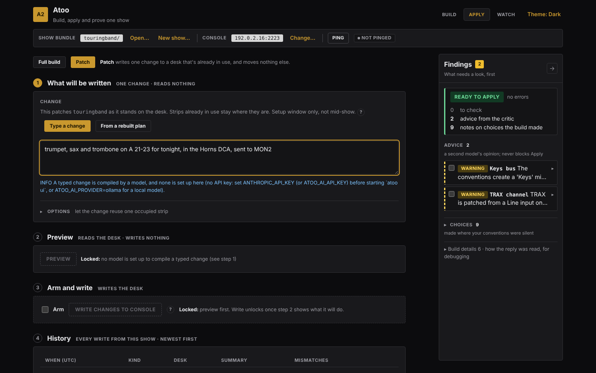

# Patch a show

Once a show is on the desk, a change goes on as a patch: you type it in plain English, Atoo works out exactly what to write, shows you, and writes only that. Nothing already in use moves. For example, a horn section turns up just before doors, and three channels have to go onto a desk that is already set up and line-checked.

**When:** in the setup window, after the full apply and before doors. Not mid-show. Save a snapshot on the desk once it is patched, so the worst a bad change can cost is a reload.

**Before you start:** the show applied to this desk ([Apply a plan](apply-to-desk.md)), the console set in the bar, and a model set up, as for a build.

## 1. Type the change

Patch shares Apply's four numbered steps: **What will be written**, **Preview**, **Arm and write** and **History**.

1. Click **Apply**, then choose **Patch** in the **Full build | Patch** control at the top.
2. In step 1, type what changed, naming the sockets you have cabled:

   > trumpet, sax and trombone on A 21-23, in the Horns DCA, sent to MON2

   Leave a socket out and one is chosen for you, and the review says which.
3. Press **Preview**, in step 2. Until a change is typed it is locked, and **Locked:** beside it says what it is waiting for.

It reads which strips on the desk are free, and each strip's name and colour (a few seconds), sends your words, the plan on the desk and your conventions to the model, and shows progress while it works. It writes nothing.

## 2. Review it

Step 2 draws the desk as its scribble strips: every channel, aux, bus, main, matrix, DCA and mute group, in its colour, with its name and number. Strips in use are drawn solid, free strips dashed, the strips this change adds have a green outline, the ones it edits a blue one, and the ones an insert moves a dashed blue one. A strip that never answered the read is hatched: it is treated as in use, never as free.

Under the drawing, **Will be written** lists every change in groups:

| Group | Means |
|---|---|
| **Added** | a new channel, going into a free strip |
| **Returned to free** | a dropped channel's strip, cleared back to unused |
| **Moved down by the insert** | a running channel that an *insert* ("insert HiHat after Snare and renumber the channels after it") moves to the next strip down: one line for every strip that moves, each rewritten whole on its new number. Undo puts them all back. Without those words, *"add HiHat after Snare"* moves nothing, and a note gives the words that would. See [Inserting a channel](patch.md#inserting-a-channel-and-renumbering-the-strips-after-it) |
| **Edited: named fields only** | something already running, changed only in the fields you named (*"HPF 100 on the vocals"*), listed old → new |
| **Modified, not written** | something running that the change did not name field by field, or a fader it did not name; left alone |
| **Refused** | a change that names something not on the desk, or has no free strip, or patches a socket past the end of the stage box on an AES50 port (`A 17` on an S16: the pre-flight panel names the box and its size) |

A new channel or bus that your conventions give a preset takes it from the preset library the show was built with, so the horns arrive with their presets and a new Horns bus with its compressor; the notes under the review say which library was used and which preset went where. A "sax" with no kind named takes the alto sax preset, and the notes say so. If no library can be found at all, the first line of the notes is a WARNING naming the presets that will be written without their values.

Then a count of what will be written and what will **not** be. If it is not what you meant, change the words and press **Preview** again. Until you do, step 2 says the preview is out of date and the write stays locked. While the preview still matches your words, the button reads **Preview again**.

## 3. Write it

1. In step 3, tick **Arm**.
2. Press **Write changes to console**.

What is written is exactly what you reviewed: the model is not asked again. Afterwards Atoo reads back every written value, and reads the strips it did not touch to prove they did not move. Step 3 says how many were written and confirmed, and names anything that did not land.

## 4. Keep it, or take it off

The change appears at the top of **History**, step 4, highlighted, under its short name and the words you typed.

- **Preview undo** on its row, then **Undo newest write** in step 3 (armed by the same **Arm**), takes it off the desk again.
- **Keep this in the show** writes it into the show's `input.csv` and `instructions.md`, so the next build includes it. Until you press it, the change is on the desk only and the show's files do not change.

## When the change cannot be compiled

A model reply Atoo cannot use stops the preview with **Failed**. The findings dock says why, and ends with the line saying which Atoo ran (*Ran as atoo 0.2.5 (…)*), so that the failure can be passed on as it stands; the footer of the page carries the same line.

A reply that is **short of what you asked** is not written either. If the model's own note says the reply is not the answer ("superseded", "needs a rerun", "I could not ..."), or it adds fewer channels than your words name (a quoted name such as "Choir R" it left out, or a count such as "add three channels"), Atoo sends it back to the model once and uses the second reply. If that one is short too, the command stops with the reason, for example *the change names "Choir R"; the reply does not add it*, and nothing is written. Say the change again, or add the missing channel by hand. A quoted pair such as "Choir L" and "Choir R" built as one stereo "Choir" counts as both.

## Edge cases

- **A strip someone else is using** is never written over. To reuse one on purpose, open **Options** in step 1, tick **Allow the change to reuse one occupied strip**, and type its label (`ch:20`).
- **A full apply after a patch** replaces the patch. The pre-flight warns you.

The command-line version is [`atoo patch`](patch.md). Building the show again with the new inputs and patching the difference onto the desk is a command-line route too: [`atoo amend`](amend.md); the Patch screen takes a typed change only.

## Next

[Capture a desk you didn't build](capture-a-desk.md): a desk that is already set up, as a show you can watch and edit.
