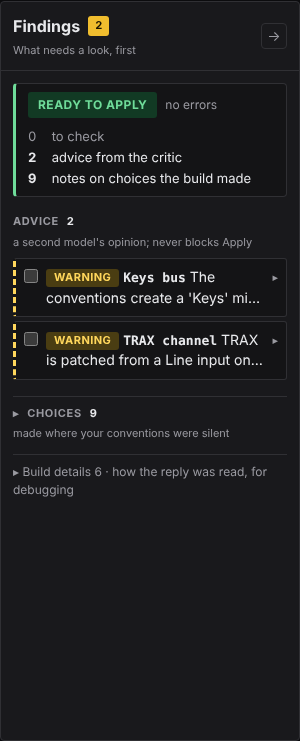

# Reading findings

Every check Atoo runs reports in the same shape: a **finding**, with
a severity, the thing it is about, what it found, and a code. This page
says what each part means and what to do about it.

## The three severities

| Severity | Means | What to do |
|---|---|---|
| **ERROR** | The desk cannot be put in that state: a socket the desk does not have, a stereo pair that starts on an even socket, a value out of range. | Fix it. A plan with an error is refused by `apply`. |
| **WARNING** | It can be written, but it is probably not what you meant: the critic disagrees with the plan, a DCA is at the floor with live channels in it. | Read it, then decide. Warnings never stop anything. |
| **INFO** | Something you should know but need not act on, most often a choice the plan made that your files did not state. | Skim. If a choice is wrong, state it next time. |

## INFO: a choice made, and said

Your conventions will not say everything. When they are silent, the plan
still has to decide, because a desk cannot be left half-set: a bus is
mono or stereo, a Matrix has a number. Atoo makes the usual choice,
and **says so** at INFO, with what it was decided from:

> busses[MON5, MON6, Drums, ...] (11 busses): width set to stereo -- the
> conventions did not state it; decided by the generator: Instructions
> add MON5 and MON6 as stereo IEM mixes ... / Mix busses conventionally
> stereo / FX busses conventionally stereo (`inferred.bus-width`)

A wrong choice is visible at soundcheck and costs a moment. If it is
wrong, add a line to your conventions (*"monitor busses are mono"*), and
the next build will not have to guess.

## The verdict

`atoo verify`, and the pre-flight on the Apply screen, end with one
line that sums up the findings:

| Verdict | Means |
|---|---|
| `VERIFIED: no findings. Plan is applicable.` | nothing to report |
| `APPLICABLE: notes only -- choices made where the conventions were silent.` | INFO only |
| `APPLICABLE: warnings only.` | warnings, no errors |
| `BLOCKED: do not apply.` | at least one error |

For example, on the Demo show, from an Atoo checkout:

```
atoo verify --plan starter/demo-show/plan.json --input starter/demo-show/input.csv
```

```
0 error(s), 0 warning(s), 4 note(s)

  [info] plan: 12 channel(s) carry a preset's values, written at the processing stage and read back like every other write: ch 1 Kick In (83), ch 2 Snare (83), ch 3 H Tom (83), ch 4 Fl Tom (83), ch 5 OH (83), ch 6 Bass (83), ch 7 E Gtr (83), ch 8 E Gtr (83), ch 9 Keys (83), ch 10 Vocal (80), ch 11 Vocal (80), ch 12 Vocal (80)  (preset.expanded)
  [info] plan: 3 bus(ses) carry a bus preset's processing, written at the processing stage and read back like every other write: Drums: 'Mix Bus' (55), Vocals: 'Mix Bus' (55), Vox Verb: 'Vox Verb' (55)  (preset.bus-expanded)
  [info] plan: 1 FX insert(s) are loaded and switched on, each read back: Vox Verb: V-REV on FX5 (saved bypassed, switched on)  (fx.inserts)
  [info] channels[Music]: aux 1 'Music' is not on the input list; built because instructions.md says 'Walk-in music ("Music") on Aux 1, stereo, source LCL 3-4. Fader at -20dB', on LCL 3-4 as it states  (reconcile.from-instructions)

APPLICABLE: notes only -- choices made where the conventions were silent.
```

The same message for several objects is one line naming them all, so
a count can be larger than the number of lines: the first note here
names twelve channels.

## Codes

The code at the end of each finding, such as `inferred.bus-width` or
`patch.stereo-pair-not-odd-even`, stays the same from version to version.
Search these pages for it, or quote it in a bug report. Its first word
says which check found it:

| Starts with | Found by |
|---|---|
| `inferred.`, `reply.`, `build.` | the build: a choice made, or how the model's draft was filled in |
| `rebuild.` | the browser, from what a rebuild changed against the plan it replaced |
| `critic.` | the critic pass, a second model call that checks the plan against your conventions |
| `patch.`, `strip.`, `group.` and others | verify: the plan against the desk's limits and your input list |
| `apply.` | the Apply pre-flight and the apply run |
| a letter code and three digits, such as `R005` or `CV016` | the checks `audit` and Watch run on the desk itself; the [Rules reference](rules-reference.md) lists every one |
| `WATCH:` | one of your own watch conditions |

A critic finding starts with a short claim, such as *Keys bus created,
but there is only one keyboard*, and then gives its reasons. The critic
is a model giving a second opinion, so its findings are WARNING at most
and never stop an apply.

## In the browser

The **Findings** panel down the right of Build and Apply opens with a
verdict, in a large tag: green **Ready to apply** when nothing is an
error, red **Blocked** with the number of errors beside it, or grey **No
plan yet** when there are findings but nothing has been built. Under it
are three counts: the things to check, the critic's advice and the notes
on choices the build made. A count that is not zero is in bold. If the
plan is older than the files it was built from, the tag is a yellow
**Stale** instead of **Ready to apply**: *The input list changed since
the last build: rebuild before applying.* A **Rebuild** button sits
beside it, and the build's and the critic's notes are about the plan as it
was built. A plan with errors still reads **Blocked**, with the same
note under it. Nothing stops you applying a stale plan, and the Apply
screen says it beside the plan; it is the plan as it was built, without
your edit.

The number beside **Findings**, also on the panel's tab when it is
folded away, counts the errors and warnings. It is grey at 0, yellow
when there are only warnings, and red when any of them is an error.

Below the verdict, each finding is one line: its severity tag (**ERROR**,
**WARNING** or **INFO**), where it is, named the way the desk names it
(`CH 23 Crowd`, `AUX 2 HOST`), and what it says. Click
the line for the rest: the explanation, the fix, the code, which check
found it, and links to the row, tile or line it is about. One finding
about several strips is one line, such as *3 strips built from
instructions.md, not on the input list*, with each strip listed inside.

- **To check**: errors, then warnings. Findings about strips come before
  findings about files. With warnings and no errors the verdict reads,
  for example, **Ready to apply · 1 to check**. After a rebuild, each
  strip that changed although nothing it is made from changed is one of
  these, `rebuild.unasked-change`: *Not asked for: gain 20 → 26 dB* on
  `CH 6 Bass DI`, with links to its row and to the step 04 list of
  changes ([What a rebuild changed](pipeline.md#what-a-rebuild-changed)).
- **Advice**: the critic's warnings, marked with a dashed edge. They are
  a second opinion and never block an apply.
- **▸ Choices**: the INFO notes that are choices, folded: what the build
  decided where your conventions were silent, and what a full apply does
  beyond the plan's own strips.
- **▸ Build details**: notes on how the build read the model's draft,
  such as the order it numbered channels in, and notes that restate your
  conventions rather than choose for them: what the Category table
  filled in, which preset values the plan carries, an effect loaded and
  read back, and what a full apply resets first (`apply.init`). They are kept for debugging, and `verify` and `build` still
  print them (`build` prints verify's copy of one only as a count, since
  it has just printed its own). A warning or an error is never put here.



Tick a finding's box once you have dealt with it, and it moves to the
folded **Addressed** list at the foot of the panel, its tag grey, so a
ticked error no longer reads as live. Watch has its own
table instead ([Watch the desk during a show](watch-a-show.md)).
