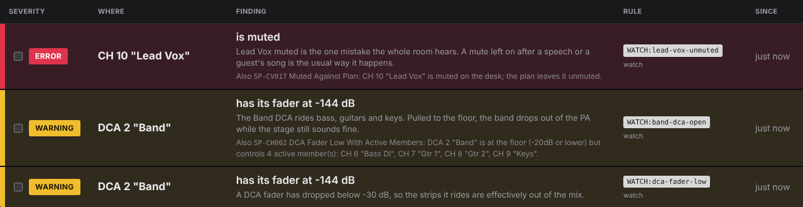
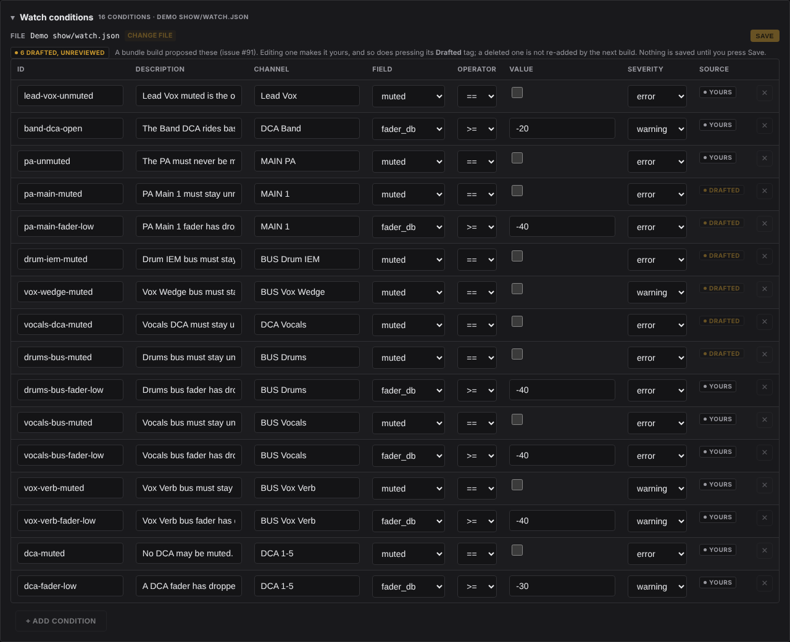

# Watch the desk during a show

Someone leaves the lead vocal muted, or pulls the Band DCA to the floor. Watch
reads the desk every few seconds and shows what is wrong now, against
your own rules and a set of built-in checks.

Watch only reads. Nothing on this screen writes to the desk.

**Before you start:** the console set in the bar, and **Ping** answering
([Apply a plan](apply-to-desk.md#1-point-it-at-the-desk)). To try it with
no desk, use the [Demo show](demo.md).

## 1. Start

1. Click **Watch**.
2. Leave **Every** at `2` seconds, or raise it on a slow network.
3. Press **Start watching**.

The pill reads *Watching* with the desk's address, and the table fills
within one reading. While a watch runs, the screen is laid out for a
glance from across the stage: one header line, then the table, and
everything else folded to a line below it.

## 2. Read the table

You can tell at a glance whether anything needs you. With nothing wrong,
the table is empty and quiet. A warning row is filled amber, an error
row red, each with a thick bar of the same colour down its left edge.
The rows are sorted errors first, then warnings, then info, with the newest
at the top of each. Here on the [Demo show](demo.md):

- **Where** is the strip the row is about, as the desk names it:
  `CH 10 "Lead Vox"`. Beside it is the claim, in large type (*is muted*,
  or a built-in rule's name), with the reason under it.
- Rules starting `WATCH:` are your **watch conditions** (below). The
  rules named by a code such as `R005` are built in. An info row is a note, in quieter type: a
  screen holding only info still looks calm.
- The show's plan adds three rules, each a warning:
  **CV016 Planned Routes All Off** (a channel whose every planned
  send and Main route is off or at the floor: *CH 1 "Kick": the plan
  sends it to Drums and Drums Comp; neither send is on*),
  **CV017 Muted Against Plan** (a channel, bus, DCA, Main or Matrix
  the plan leaves unmuted, muted on the desk; never the talkback mic),
  and, when the plan loads an FX bus's effect from a bus preset,
  **CV015 FX Bus Effect Contradicts Plan** (that bus's insert switched
  off, the reverb bypassed, or the engine holding another effect). On the
  Demo, Lead Vox muted shows CV017 folded under the show's own
  condition (*Also CV017 Muted Against Plan*), and the Vox Verb bus is
  sometimes switched off to show CV015.
- Watch reads the output sockets the plan patches and the outputs of any
  AES50 stage box on the desk, so monitor busses patched to a stage box
  are not called unrouted. A Matrix the phones listen to is not
  "unpatched".
- **One fault, one row.** When one of your conditions and a built-in
  rule catch the same thing (your `DCA Band` fader condition and CH002
  both see the Band DCA at the floor), the row is yours, at your
  severity, with the built-in named under it: *Also CH002 DCA Fader
  Low With Active Members*.
- **A row clears itself** when the fault is fixed on the desk: the table
  is the desk as it is now, not a log. To hide one you have already seen,
  [suppress it](#suppress-what-you-have-seen).
- **Updated 12s ago**, in the header beside the counts, is the time of
  the last reading. If readings stop arriving while you watch, it turns
  to a warning and reads **No reading for 45s**, and the table greys out.
  The table then shows how the desk was at that last reading, not how it
  is now. Check the desk's network, or Stop and Start again.
- A **Coverage** line under the header names any rule the reading could
  not check, so a short table is not mistaken for a healthy desk.

Below the table, two lines open when clicked:

- **This watch** says which console it reads, which strip each named
  condition found at Start (*Resolved at Start: DCA Band → DCA 2, MAIN
  PA → MAIN 1*), and how many findings were already present at the
  start. A condition that is **not watched**, because its name matched
  no strip, shows a warning badge on this line.
- **Watch conditions** is the editor (below).

Both open again when you press **Stop**. Closing `atoo ui` stops the
watch too.

### Flash on new

**Flash on new** in the header is off until you turn it on, and this
browser remembers your choice. When it is on, a new warning or error
flashes the whole screen once, in its colour, for less than half a
second. It does not repeat while the fault stands, and an info never
flashes. If your computer is set to reduce motion, the screen's edges
glow in that colour for a few seconds instead.

### Suppress what you have seen

A warning you know about and cannot fix tonight should not take the eye
from the next one. Hiding a finding only changes this page; nothing is
sent to the desk.

- **One finding:** tick the box at the start of its row. The row moves to
  **Suppressed (1)**, folded under the table. Open it and untick the box
  to bring the row back.
- **Every warning, or every info:** click its count in the header. The
  count is struck through and reads, for example, *0 Warning (4
  hidden)*. Click it again to show them. Errors cannot be hidden this
  way, only one at a time: an error is a setting that cannot work.

A hidden finding is left out of the counts (they show what is in the
table, with the hidden number beside them), does not colour the screen,
and does not set off **Flash on new**. The Error and Warning counts take
their colour only for rows still in the table; the Info count stays blue
while any info is hidden by its box (*0 Info (3 hidden)*), as it is in
**Suppressed**.

A suppression lasts while the same fault stands. If the fault clears and
later comes back, it is shown again as a new finding, and flashes if
**Flash on new** is on: a fault that returns may be a new problem.
**Start** clears every suppression; this browser does not keep them.

## 3. Say what matters tonight: watch conditions

The **Watch conditions** panel holds this show's own rules, saved in its
`watch.json`. It is open when no watch is running; during one, click its
line under the table to open it.

Each row is one check on one channel, bus or DCA:

| Channel | Field | Operator | Value | Severity |
|---|---|---|---|---|
| `Lead Vox` | `muted` | `==` | `false` | error |
| `Playback` | `fader_db` | `>` | `-60` | warning |
| `DCA Band` | `fader_db` | `>=` | `-20` | warning |
| `MAIN PA` | `muted` | `==` | `false` | error |

**Field** is one of `muted`, `fader_db`, `dca`, `mute_group` or `patch`.
Give each row an **ID** and a **Description**: the description is what
the table shows when it fires, so write the reason, *"Playback carries
the backing tracks."*

1. Press **+ Add condition**, fill in the row, and press **Save**.
2. A watch that is running uses it from its next reading. No restart.

**Source** says who wrote each row. A build drafts a starting set, marked
**Drafted**; edit one, or press its **Drafted** tag, and it becomes
**Yours**. A drafted row you delete is not added back by the next build.

[Your own alerts: watch conditions](watch-conditions.md)
has the full reference: matching by position, range or name.

## When it does not work

- **The pill reads** *no reply*: check the address with **Ping**, and see
  [Troubleshooting](troubleshooting.md#atoo-cannot-reach-the-console).
- **A condition never fires**: its **Channel** must match a name on the
  desk. A kind and a name (`DCA Band`) that matched nothing shows as
  **not watched** on the **This watch** line under the table. A Main or
  Matrix name is read once, at Start: press **Stop** and **Start
  watching** after renaming one.

The command-line version is
[`atoo watch`](watch.md).
